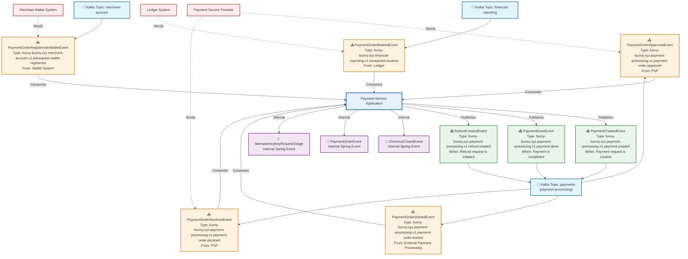

# Payment Service Events and Commands Flow

This diagram shows the events and commands that are produced and consumed by the Payment Service application using Kafka messaging.

## Event Flow Diagram

## Event Details

### Events Published by Payment Service

| Event Name | Event Type | Kafka Topic | Trigger | Description |
|------------|------------|-------------|---------|-------------|
| **PaymentCreatedEvent** | `funny-bunny.xyz.payment-processing.v1.payment.created` | `payments` | When a payment request is created | Initiates the payment processing flow |
| **PaymentDoneEvent** | `funny-bunny.xyz.payment-processing.v1.payment.done` | `payments` | When payment is completed | Signals successful payment completion |
| **RefundCreatedEvent** | `funny-bunny.xyz.payment-processing.v1.refund.created` | `payments` | When a refund is requested | Initiates the refund processing flow |

### Events Consumed by Payment Service

| Event Name | Event Type | Kafka Topic | Source | Description |
|------------|------------|-------------|--------|-------------|
| **PaymentOrderStartedEvent** | `funny-bunny.xyz.payment-processing.v1.payment-order.started` | `payment-processing` | External Payment System | Notifies that payment order processing has started |
| **PaymentOrderApprovedEvent** | `funny-bunny.xyz.payment-processing.v1.payment-order.approved` | `payment-processing` | Payment Service Provider | Notifies that payment has been approved |
| **PaymentOrderDeclinedEvent** | `funny-bunny.xyz.payment-processing.v1.payment-order.declined` | `payment-processing` | Payment Service Provider | Notifies that payment has been declined |
| **PaymentOrderBookedEvent** | `funny-bunny.xyz.financial-reporting.v1.transaction.booked` | `financial-reporting` | Ledger System | Notifies that transaction has been recorded in ledger |
| **PaymentOrderRegisteredInWalletEvent** | `funny-bunny.xyz.merchant-account.v1.transaction.wallet-registered` | `merchant-account` | Merchant Wallet System | Notifies that payment has been registered in merchant wallet |

### Internal Application Events

| Event Name | Type | Description |
|------------|------|-------------|
| **CheckoutClosedEvent** | Spring Application Event | Internal event when checkout process is completed |
| **PaymentOrderEvent** | Spring Application Event | Internal event for payment order processing |
| **IdempotencyKeyRequestUsage** | Spring Application Event | Internal event for tracking idempotency key usage |

## Kafka Topics Configuration

- **payment-processing**: Main topic for payment events (3 partitions, 3 replicas)
- **financial-reporting**: Topic for financial and ledger events
- **merchant-account**: Topic for merchant wallet and account events

## Technology Stack

- **Spring Boot 3.4.0** with Spring Kafka
- **CloudEvents** specification for event formatting
- **Kafka** as the message broker
- **PostgreSQL** for persistence
- **OpenTelemetry** for observability